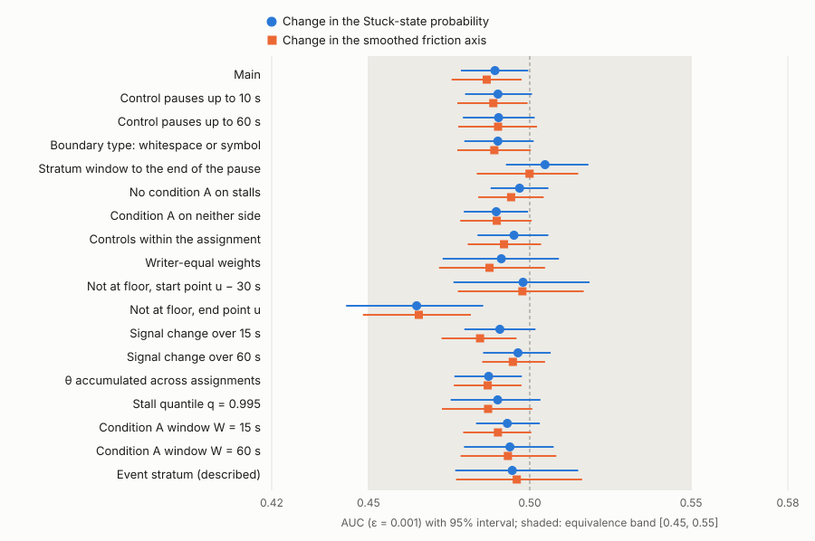

<h1 align="center">Stall Run-up Equivalence</h1>

<p align="center">
  事前登録した同等性の検定のコード・条件・集計の結果。打鍵の状態推定器の 2 つの信号の 30 秒の変化は、<br>
  停滞に至る手前と、揃えた短い休止の手前とを見分けるか。
</p>

<p align="center">
  <a href="LICENSE-MIT"></a>
  <a href="LICENSE-docs"></a>
  
  
  <a href="https://osf.io/mrkxt"></a>
  <a href="https://doi.org/10.5281/zenodo.24014042"></a>
</p>

<p align="center"><a href="README.md">English</a> | <b>日本語</b></p>

この repository は、原稿 *A keystroke state estimator's 30-second signal changes before code-writing stalls: within
0.025 AUC of matched pauses in a preregistered holdout*（Mikoto Miura）に付随する。事前登録・逸脱・2 つの開始の記録・結果は
Open Science Framework で公開している: [mrkxt](https://osf.io/mrkxt)（事前登録）・[fqgcp](https://osf.io/fqgcp)（逸脱）・
[ajg2x](https://osf.io/ajg2x)（2 回目の開始の記録）・[uj6cy](https://osf.io/uj6cy)（結果と来歴）。この公開物は Zenodo に
ある: [10.5281/zenodo.24014042](https://doi.org/10.5281/zenodo.24014042)（全版。0.1.0 は
[10.5281/zenodo.24014043](https://doi.org/10.5281/zenodo.24014043)）。

<p align="center">
  
</p>

推定器は、手で置いた係数（このデータから学んだものではない）で、打鍵の時刻を 1 秒ごとの信号に変える。文字の産出が
停滞に至った休止と、同じ書き手の 2〜30 秒の揃えた休止（停滞に至らなかったもの）のそれぞれについて、休止の始まりまでの
30 秒の 2 つの信号（推定器の Stuck 状態の確率と、平滑化した摩擦の軸）の変化をとり、停滞と対照の AUC が事前に決めた
帯 [0.45, 0.55] の内側にあるかを確かめた。

<p align="center">
  
</p>
<p align="center"><sub>CS1 2019 年版の取り置き（139 人）。<code>tools/readme_media.py</code> が
<code>results_holdout/confirm_holdout.json</code> から描く。<code>--check</code> で、すべての値が原稿の補足の表 S と
一致することを確かめる。原稿の数はこの図から取っていない。</sub></p>

## 中身

| パス | 中身 |
|---|---|
| `estimator/` | 打鍵の状態推定器と `gse-replay`。論文が使った版を著者の開発 repository から切り出したもの。テスト・来歴・一致の門つき（`estimator/README.md`） |
| `experiments/20261104-cs1-landscape/` | CS1 のデータの変換・取り置きの抽選・停滞の俯瞰 |
| `experiments/20261105-findings-paper1-prefreeze/` | 凍結の前の計算・確認のスクリプト `scripts/confirm_p1.py`・検証済みのファイルの manifest・逸脱・見た書き手の結果（`results/`）と取り置きの結果（`results_holdout/`） |
| `experiments/20261106-findings-paper1-exploration/` | 登録の外の探索（陽性対照・学習器との比べ・CoAuthor と KLiCKe・CS1 2021 年版） |
| `experiments/20261031-*`・`20261101-*`・`20261102-*`・`20261103-*` | 論文のスクリプトが読み込む前の実験の変換と解析のスクリプト・実行の手順・条件 |
| `paper/` | 原稿の LaTeX（組み方は `paper/BUILD.md`） |
| `tools/` | この公開物の検査と図のスクリプト |
| `gse-commits.tsv` | `experiments/` の各ファイルが開発 repository に最初と最後に入ったコミットと時刻（UTC）。条件と結果がいつコミットされたかを比べられる（履歴そのものは公開していない） |

各実験のディレクトリには、`conditions*.md`（計算の前に書いてコミットした条件）・`notes.md`（回したことと分かったこと）・
`SEED`・`results/` がある。記録は書いたときのまま日本語で、英語の説明は原稿にある。

## 入れていないものと理由

- **データと書き手ごとのもの。** CS1 のファイルは著者への申請で配布され、公開は集計値だけと約束した。データ・休止ごとの
  推定の行・書き手ごとの値は入れず、ここにある結果は集計値である。`tools/check_release.py` は形の検査で、生データの
  ファイル・データの id の形・書き手ごとになりうる大きさ（30 件以上）の JSON の配列と辞書と Markdown・TeX の表・秘密と
  手元のパスが、ファイルにもコミットの記録にも無いことを確かめる（意味は見ない）。`tools/control_check_release.sh` が
  検出器ごとに 1 件ずつ混ぜて、どれも見つかることを確かめる。
- **取り置きの書き手の一覧。** データの著者の同意が得られれば足す。SHA-256 は `a5a32fce…bdc47`
  （`experiments/20261105-findings-paper1-prefreeze/data.md`）で、`experiments/20261104-cs1-landscape/scripts/make_holdout_cs1.py`
  に seed `20261104` を与えるとデータから引き直せる。
- **開発 repository の残り。** 推定器は非公開の repository（GSE）から来ており、推定器と replay の道具だけを切り出した。
  記録の中のコミットの id はその repository を指し、著者の照合のために書いている。検証済みのファイルの manifest のうち
  6 本はその repository の文書で、ここには入れていない。うち 3 本（事前登録の日本語版と英語版、英語版の照合）は OSF の
  登録 [mrkxt](https://osf.io/mrkxt) に添えてある。

## 検査

```
bash tools/verify.sh
```

が次を回し、すべて通ったときだけ 0 で終わる。

1. `tools/check_manifest.py`: manifest `experiments/20261105-findings-paper1-prefreeze/confirm-manifest.sha256` の
   SHA-256 が 2 回目の開始の記録の値（`c821ae03…f6b0`・`results_holdout/start.json`）と同じで、そこに挙がる
   ファイルのうちこの公開物に入れたものの SHA-256 が一致する。登録上の `src-tauri/prereg/p1-episode.json`（停滞の定義）は、
   バイトが同じ `estimator/prereg/p1-episode.json` で照合する。最初の manifest（19 行・`9a1a7f14…28da9b`）は事前登録に
   添えてある。
2. `estimator/` で `cargo test --locked` と `provenance/check_provenance.py --self`。
3. `tools/readme_media.py --check`: 上の図が原稿の表 S と同じ。
4. `tools/check_release.py` とその陽性対照。

## 解析を回し直す

Rust 1.88 以上、`experiments/20261105-findings-paper1-prefreeze/requirements-confirm.txt` の包みを入れた Python 3.14、
公開データが要る。

| データ | 入手先 | 置き場 |
|---|---|---|
| CS1 2019 年版と 2021 年版の打鍵 | Harvard Dataverse、doi:[10.7910/DVN/6BPCXN](https://doi.org/10.7910/DVN/6BPCXN)（ファイルは著者への申請） | `$DATA_DIR/cs1/raw/<年>/keystrokes.csv` |
| CoAuthor v1.0 | <https://coauthor.stanford.edu>（"Download writing sessions" と 2 つのメタデータの表） | `$DATA_DIR/coauthor/raw/` |
| KLiCKe | <https://github.com/terryyutian/KLiCKe-Corpus> が指す Drive のフォルダ（`WritingTask.zip`） | `$DATA_DIR/klicke/raw/` |

使った各ファイルの SHA-256 は、そのファイルを最初に読んだ実験の `data.md` にある。そのうえで:

```
cd estimator && cargo build --release --locked && cd ..
export DATA_DIR=/path/outside/this/repo GSE_REPLAY="$PWD/estimator/target/release/gse-replay"
bash experiments/20261104-cs1-landscape/run.sh              # 変換・取り置きの抽選・俯瞰
bash experiments/20261105-findings-paper1-prefreeze/run.sh  # 凍結の前の計算（見た書き手）
bash experiments/20261105-findings-paper1-prefreeze/run-confirm-seen.sh
```

`run-confirm-holdout.sh` は、凍結の後に OSF の記録と照らして 1 回だけ回した 2 段の手順である。作業ツリーが当時の
コミットであることを確かめるので、回し直すスクリプトではなく、回したことの記録として置いている。確認そのものは
`scripts/confirm_p1.py` で、呼び方はそのスクリプトと `results_holdout/provenance_holdout.json` にある。スクリプトは中間
（書き手ごとの行を含む）を repository の外の `$DATA_DIR` に書き、集計の結果だけを各実験の `results/` に書く。

ここの推定器は、論文の計算のパイプラインが見た書き手で行ったすべての呼び出しで、論文が使った build（SHA-256
`26cae610…33bb3`）とバイト単位で同じ出力を返した。比べ方と件数は `estimator/README.md` にある。この門を回し直すには
基準の build が要り、それは配布していない。

## ライセンス

コード（README を除く `estimator/`・`experiments/` のスクリプト・`tools/`）: MIT または Apache-2.0 のいずれか
（`LICENSE-MIT`・`LICENSE-APACHE`）。記録・結果・図・README・原稿の LaTeX: CC BY 4.0（`LICENSE-docs` に一覧）。
