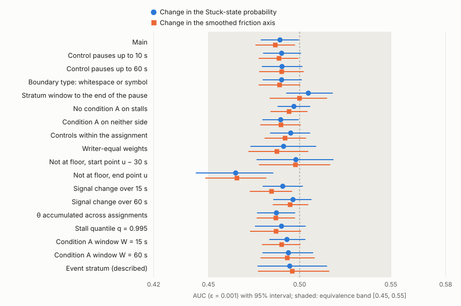

<h1 align="center">Stall Run-up Equivalence</h1>

<p align="center">
  Code, conditions and aggregate results of a preregistered equivalence test: does the 30-second change in two signals<br>
  of a keystroke state estimator tell the run-up to a stall from the run-up to a matched short pause?
</p>

<p align="center">
  <a href="LICENSE-MIT"></a>
  <a href="LICENSE-docs"></a>
  
  
  <a href="https://osf.io/mrkxt"></a>
</p>

<p align="center"><b>English</b> | <a href="README.ja.md">日本語</a></p>

This repository accompanies the manuscript *A keystroke state estimator's 30-second signal changes before code-writing
stalls: within 0.025 AUC of matched pauses in a preregistered holdout* (Mikoto Miura). The preregistration, the
deviation, the two start records and the results are public on the Open Science Framework:
[mrkxt](https://osf.io/mrkxt) (preregistration), [fqgcp](https://osf.io/fqgcp) (deviation),
[ajg2x](https://osf.io/ajg2x) (second start record), [uj6cy](https://osf.io/uj6cy) (results and provenance).

<p align="center">
  
</p>

The estimator turns keystroke timing into per-second signals with hand-set coefficients (they were not learned from
these data). For each pause that became a stall in character production, and for matched pauses of 2–30 s by the same
writer that did not, the test takes the change of two signals over the 30 s before the pause starts (the probability of
the estimator's Stuck state, and a smoothed friction axis) and asks whether the AUC of stalls against controls lies
inside the band [0.45, 0.55] set in advance.

<p align="center">
  
</p>
<p align="center"><sub>Holdout of the CS1 2019 data (139 students). Drawn by <code>tools/readme_media.py</code> from
<code>results_holdout/confirm_holdout.json</code>; <code>--check</code> confirms every value equals the supplement's
Table S of the manuscript. No number of the manuscript comes from this figure.</sub></p>

## What is here

| path | what it is |
|---|---|
| `estimator/` | the keystroke state estimator and `gse-replay`, cut out of the authors' development repository at the version the paper used, with its own tests, provenance and equivalence gate (see `estimator/README.md`) |
| `experiments/20261104-cs1-landscape/` | conversion of the CS1 data, the holdout draw, and the descriptive overview of stalls |
| `experiments/20261105-findings-paper1-prefreeze/` | the computations before the freeze, the confirmation script `scripts/confirm_p1.py`, the manifest of verified files, the deviation, and the results on seen writers (`results/`) and on the holdout (`results_holdout/`) |
| `experiments/20261106-findings-paper1-exploration/` | the explorations outside the registration (positive controls, the comparison with learners, CoAuthor and KLiCKe, CS1 2021) |
| `experiments/20261031-*`, `20261101-*`, `20261102-*`, `20261103-*` | conversion and analysis scripts of earlier experiments that the paper's scripts import, with their run scripts and conditions |
| `paper/` | the LaTeX sources of the manuscript (`paper/BUILD.md`) |
| `tools/` | the checks of this release and the figure script |
| `gse-commits.tsv` | for every file under `experiments/`, the commit and time (UTC) at which it first and last entered the development repository, so that a reader can compare when each set of conditions and each result was committed (the history itself is not public) |

Every experiment directory has `conditions*.md` (written and committed before the computation), `notes.md` (what was
run and found), `SEED`, and `results/`. These records are in Japanese, as they were written; the manuscript is the
English account.

## What is not here, and why

- **The data and anything per writer.** The CS1 files are released by their authors on request, and we agreed to
  publish only aggregate values. So the data, the per-pause estimate rows and every per-writer value are left out;
  the results here are aggregates. `tools/check_release.py` checks that no file holds raw data, identifiers of the
  shapes the datasets use, per-unit tables or secrets, with positive controls in `tools/control_check_release.sh`.
- **The list of holdout writers.** It will be added if the authors of the data agree. Its SHA-256 is
  `a5a32fce…bdc47` (in `experiments/20261105-findings-paper1-prefreeze/data.md`), and
  `experiments/20261104-cs1-landscape/scripts/make_holdout_cs1.py` with seed `20261104` redraws it from the data.
- **The rest of the development repository.** The estimator comes from a private repository (GSE); only the estimator
  and the replay tool were cut out. The commit ids in this repository's records refer to that repository and are
  given for the authors' own checks. Six files of the manifest of verified files are documents of that repository and
  are not included; three of them (the preregistration in Japanese and English, and the check of the English version)
  are attached to the OSF registration [mrkxt](https://osf.io/mrkxt).

## Checks

```
bash tools/verify.sh
```

runs the following and exits with 0 only if all pass:

1. `tools/check_manifest.py`: the manifest `experiments/20261105-findings-paper1-prefreeze/confirm-manifest.sha256`
   has the SHA-256 recorded in the second start record (`c821ae03…f6b0`, in `results_holdout/start.json`), and each
   file it lists that is part of this release has its SHA-256. The definition of a stall, registered as
   `src-tauri/prereg/p1-episode.json`, is the byte-identical `estimator/prereg/p1-episode.json`. The first manifest
   (19 entries, `9a1a7f14…28da9b`) is attached to the preregistration.
2. `cargo test --locked` and `provenance/check_provenance.py --self` in `estimator/`.
3. `tools/check_release.py` and its positive controls.

`python3 -I tools/readme_media.py --check` checks the figure against the manuscript's table.

## Rerunning the analyses

You need Rust 1.88 or later, Python 3.14 with the packages in
`experiments/20261105-findings-paper1-prefreeze/requirements-confirm.txt`, and the public data:

| data | where to get it | place it at |
|---|---|---|
| CS1 2019 and 2021 keystrokes | Harvard Dataverse, doi:[10.7910/DVN/6BPCXN](https://doi.org/10.7910/DVN/6BPCXN) (files on request to the authors) | `$DATA_DIR/cs1/raw/<year>/keystrokes.csv` |
| CoAuthor v1.0 | <https://coauthor.stanford.edu> ("Download writing sessions" and the two metadata sheets) | `$DATA_DIR/coauthor/raw/` |
| KLiCKe | the Drive folder linked from <https://github.com/terryyutian/KLiCKe-Corpus> (`WritingTask.zip`) | `$DATA_DIR/klicke/raw/` |

The SHA-256 of each file we used is in the `data.md` of the experiment that first read it. Then:

```
cd estimator && cargo build --release --locked && cd ..
export DATA_DIR=/path/outside/this/repo GSE_REPLAY="$PWD/estimator/target/release/gse-replay"
bash experiments/20261104-cs1-landscape/run.sh              # conversion, holdout draw, overview
bash experiments/20261105-findings-paper1-prefreeze/run.sh  # computations before the freeze (seen writers)
bash experiments/20261105-findings-paper1-prefreeze/run-confirm-seen.sh
```

`run-confirm-holdout.sh` is the two-stage procedure that was run once, after the freeze, against the OSF records; it
checks that the work tree is the one committed at that time, so it is kept as the record of what was run rather than
as a script to rerun. The confirmation itself is `scripts/confirm_p1.py`; how it was called is in that script and in
`results_holdout/provenance_holdout.json`. The scripts write intermediates (which hold per-writer rows) under
`$DATA_DIR`, outside the repository, and only aggregate results to the experiment's `results/`.

The estimator here gives the same output, byte for byte, as the build the paper used (SHA-256 `26cae610…33bb3`) on
every call the paper's pipelines made on seen writers; the comparison and its counts are in `estimator/README.md`.
Rerunning that gate needs the reference build, which is not distributed.

## License

Code (`estimator/`, the scripts under `experiments/` and `tools/`): MIT or Apache-2.0, at your option
(`LICENSE-MIT`, `LICENSE-APACHE`). Records, results, figures and the manuscript sources: CC BY 4.0 (`LICENSE-docs`).
